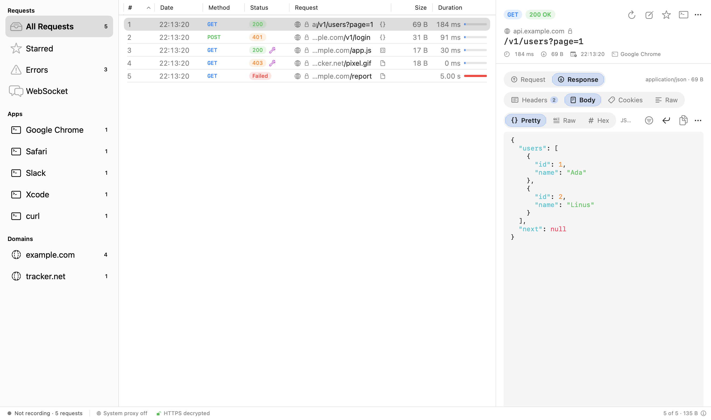
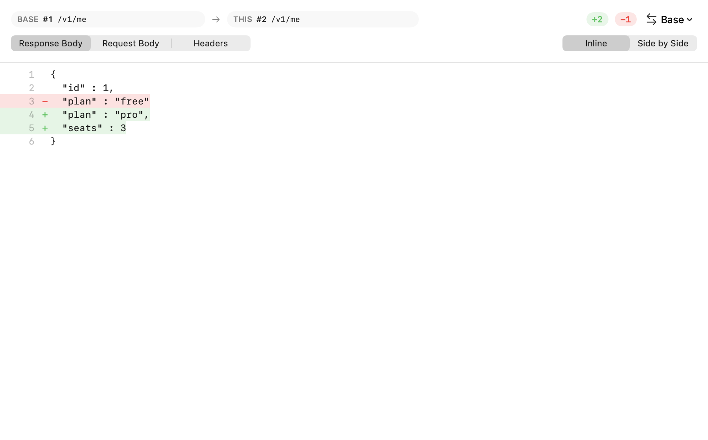
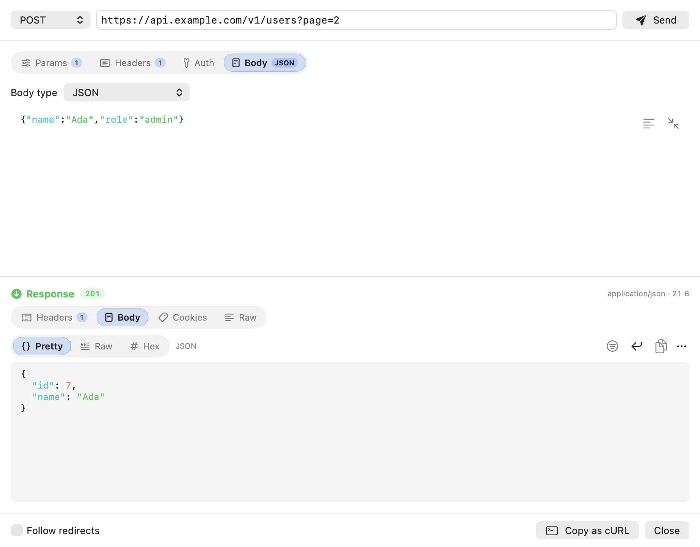
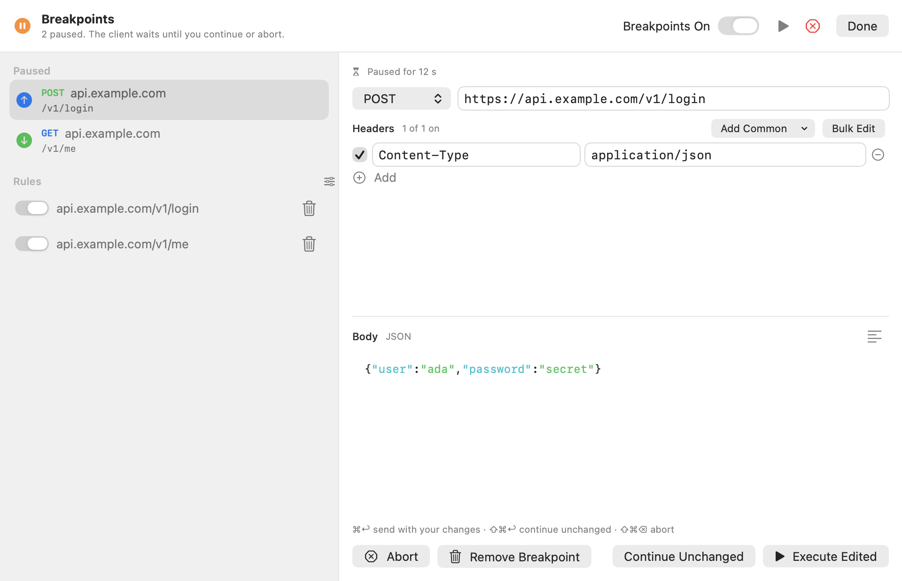
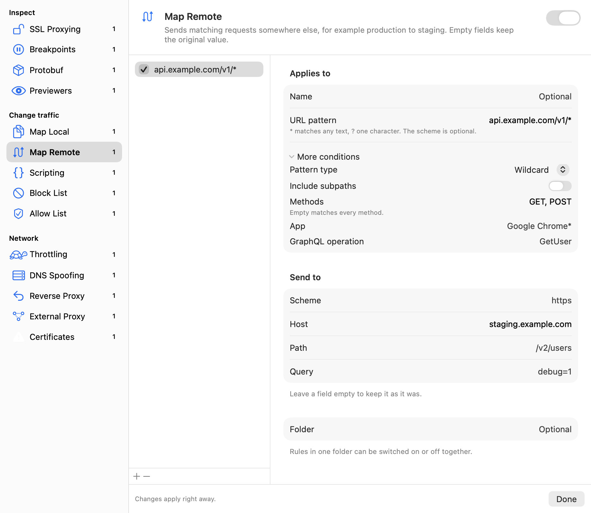
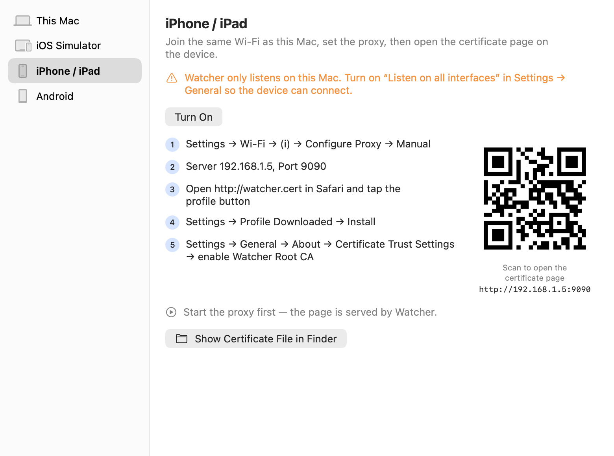

<p align="center">
  
</p>

<h1 align="center">Watcher: free HTTP and HTTPS debugging proxy for macOS</h1>

<p align="center">
  Capture, decrypt, inspect, mock and modify network traffic from your Mac, iOS Simulators, iPhones, iPads and Android
  devices. A native, open-source alternative to Charles Proxy and Proxyman.
</p>

<p align="center">
  <a href="https://github.com/mkemalgokce/watcher/actions/workflows/ci.yml"></a>
  <a href="https://github.com/mkemalgokce/watcher/releases/latest"></a>
  <a href="LICENSE"></a>
  
  <a href="https://github.com/sponsors/mkemalgokce"></a>
</p>

<p align="center">
  <a href="https://github.com/mkemalgokce/watcher/releases/latest"><b>Download for macOS</b></a> ·
  <a href="#features">Features</a> ·
  <a href="#getting-started">Getting started</a> ·
  <a href="#command-line-and-mcp-server">Command line</a> ·
  <a href="CONTRIBUTING.md">Contributing</a>
</p>

<p align="center">
  
</p>

Watcher is a man-in-the-middle HTTP(S) proxy built for developers who debug APIs, mobile apps and web apps on a Mac. It is
a native SwiftUI app, with a command line tool for scripts and CI, and an MCP server so AI coding agents can read
captured traffic, add rules and send requests. It is free, open source (MIT) and has no account, telemetry or subscription.

## Features

### Capture and decrypt HTTPS traffic

- HTTP/1.1 and HTTP/2 (ALPN), WebSocket frames, Server-Sent Events and streamed bodies.
- HTTPS decryption with a local root certificate and per-host certificates; SSL Proxying include and exclude lists.
- A SOCKS5 listener, and a one-click macOS system proxy that is restored on quit and after a crash.
- Requests grouped by the app that sent them and by domain.

### Inspect requests and responses

- Request and response side by side: headers, query, form and multipart parameters, cookies, raw and hex views.
- Previews for JSON, images, HTML (rendered offline, scripts off), PDF, audio, video, GraphQL and Protobuf/gRPC.
- JWT and Base64 decoding, timing details, and a diff of any two responses.
- Syntax highlighting that colours only the visible lines, so a 30 MB response stays responsive.
- One search field with tokens for method, status, content type and host.

<p align="center">
  
  
</p>

### Mock, rewrite and debug

- **Breakpoints**: pause a request or response, edit it, then continue or abort.
- **Map Local and Map Remote**: answer from a local file, or send production traffic to staging.
- **Scripting**: change requests and responses with JavaScript.
- **Block and Allow Lists, DNS Spoofing, Reverse Proxy, External Proxy (HTTP, SOCKS, PAC), Network Throttling, No Caching.**
- Rules match by wildcard, regex, method, GraphQL operation or sending app, and can be grouped in folders.

<p align="center">
  
  
</p>

### Compose, export and import

- Build or repeat requests (JSON, form, multipart, GraphQL, files), import a cURL command, mock a response.
- Export HAR, CSV, session files and workspaces; copy as cURL, Swift, Python, JavaScript, Go, Ruby or PHP.
- Import Charles sessions and settings.

### Debug iOS and Android apps

Trust the certificate on this Mac, iOS Simulators, iPhone and iPad (profile and QR code) and Android (`adb`), with
step-by-step setup for each.

<p align="center">
  
</p>

## Getting started

1. Download `Watcher-<version>.dmg` from the [latest release](https://github.com/mkemalgokce/watcher/releases/latest) and
   drag Watcher to Applications. Releases are signed with a Developer ID and notarized by Apple.
2. Open Watcher. The welcome sheet walks through trusting the root certificate.
3. Press **Record** (⌘E). Watcher listens on `127.0.0.1:9090`. Turn on the system proxy (⇧⌘Y) to capture the whole Mac.
4. To capture a phone or simulator, open **Set Up a Device** (⇧⌘D).
5. Press **Pause** to stop; your original network settings come back.

Press ⌘/ in the app for every keyboard shortcut.

Requires macOS 14 or later. Release builds are for Apple silicon. To build from source (Xcode 26 or later):

```sh
git clone https://github.com/mkemalgokce/watcher.git
cd watcher
tools/build-app.sh   # writes build/Watcher.app, signed ad hoc for this Mac
```

## Command line and MCP server

`watcher-cli` runs the same proxy headless, for scripts and CI, and gives AI agents the captured traffic and the rules over MCP.

```sh
swift run watcher-cli start --har session.har    # capture to a HAR file
swift run watcher-cli tool block-list on
swift run watcher-cli rules export rules.json    # also: rules import, rules import-charles
swift run watcher-cli install-simulator-cert --device booted
swift run watcher-cli android cert               # also: android list | proxy --port 9090 | unproxy
swift run watcher-cli mcp                        # MCP server on stdin/stdout
curl -x http://127.0.0.1:9090 --cacert ~/.watcher/watcher-ca.pem https://example.com/
```

The app and the CLI share `~/.watcher/settings.json`; a running Watcher picks up edits within a second.

## Scripting

```js
async function onRequest(context, url, request) {   // request: method, headers, queries, body
  request.headers["X-Watcher"] = "1";
  return request;
}
async function onResponse(context, url, request, response) {   // response: statusCode, headers, body, bodyFilePath
  response.statusCode = 200;
  return response;
}
```

## Limits

Bodies a tool must read (scripting, breakpoints, GraphQL matching, throttling) are buffered up to 64 MB; streamed bodies
keep their first 1 MB; a WebSocket keeps its newest 2000 messages; scripts time out after 10 s. Binary Charles sessions
(`.chls`, `.chlz`) need Charles installed.

## Contributing and support

Issues and pull requests are welcome; see [CONTRIBUTING.md](CONTRIBUTING.md) and report security problems as described in
[SECURITY.md](SECURITY.md). Watcher is made by [Mustafa Kemal Gökçe](https://github.com/mkemalgokce); if it saves you time,
consider [sponsoring its development](https://github.com/sponsors/mkemalgokce).

## License

[MIT](LICENSE)

Charles Proxy and Proxyman are trademarks of their respective owners. Watcher is an independent project and is not
affiliated with them.
